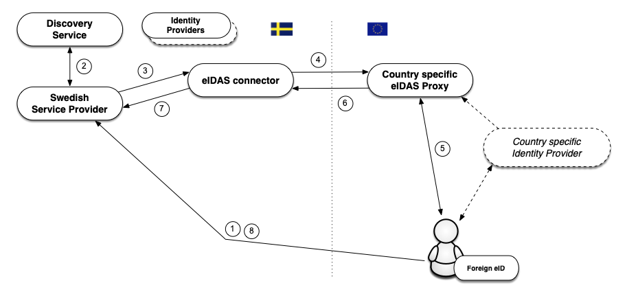

</img>
</img>

</img>

# Introduction to the Sweden Connect Technical Framework

### 2026-10-19

Registration number: **2019-267**

---

Copyright &copy; <a href="https://www.digg.se">The Swedish Agency for Digital Government (Digg)</a>, 2015-2026. All Rights Reserved.

## Table of Contents

1. [**Introduction**](#introduction)

    1.1. [Overview](#overview)

    1.2. [The Assurance Framework and Levels of Assurance](#the-assurance-framework-and-levels-of-assurance)

    1.3. [Service for Collection, Administration and Publishing of Metadata](#service-for-collection-administration-and-publishing-of-metadata)

    1.4. [Discovery Service](#discovery-service)

    1.5. [Relying Party Integration](#relying-party-integration)

    1.6. [Signatures](#signatures)

    1.7. [The Technical Framework and eIDAS](#the-technical-framework-and-eidas)

    1.7.1. [Foreign eID Authentication](#foreign-eid-authentication)
    
    1.7.2. [Signing using a Foreign eID](#signing-using-a-foreign-eid)

    1.7.3. [Handling of Identities](#handling-of-identities)
    
    1.7.4. [Swedish eIDs in Foreign Services](#swedish-eids-in-foreign-services)

2. [**Technical Specifications**](#technical-specifications)

    2.1. [Common Specifications](#common-specifications)

    2.1.1. [Sweden Connect – Registry for Identifiers](#sc-registry-for-identifiers)

    2.1.2. [Sweden Connect – Security Requirements](#sc-security-requirements)

    2.2. [Profiles and Specifications for SAML](#profiles-and-specifications-for-saml)
    
    2.2.1. [Deployment Profile for the Swedish eID Framework](#deployment-profile-for-the-swedish-eid-framework)
    
    2.2.2. [Attribute Specification for the Swedish eID Framework](#attribute-specification-for-the-swedish-eid-framework)
    
    2.2.3. [Entity Categories for the Swedish eID Framework](#entity-categories-for-the-swedish-eid-framework)

    2.2.4. [eIDAS Constructed Attributes Specification for the Swedish eID Framework](#eidas-constructed-attributes-specification-for-the-swedish-eid-framework)
    
    2.2.5. [Principal Selection in SAML Authentication Requests](#principal-selection-in-saml-authentication-requests)
    
    2.2.6. [User Message Extension in SAML Authentication Requests](#user-message-extension-in-saml-authentication-requests)
    
    2.3. [Profiles and Specifications for OpenID Connect](#profiles-and-specifications-for-openid-connect)
        
    2.3.1. [OpenID Connect Profile for Sweden Connect](#openid-connect-profile-for-sweden-connect)
    
    2.3.2. [OpenID Connect Claims and Scopes Specification for Sweden Connect](#openid-connect-claims-and-scopes-specification-for-sweden-connect)

    2.4. [Signature Specifications](#signature-specifications)
    
    2.4.1. [Implementation Profile for using OASIS DSS in Central Signing Services](#implementation-profile-oasis-dss)
    
    2.4.2. [DSS Extension for Federated Central Signing Services](#dss-extensions)
    
    2.4.3. [Certificate Profile for Certificates Issued by Central Signing Services](#certificate-profile-css)
    
    2.4.4. [Signature Activation Protocol for Federated Signing](#signature-activation)

    2.5. [The Sweden Connect Federation](#the-sweden-connect-federation)

    2.5.1. [Tekniska anslutningsregler för Sweden Connect-federationen](#tekniska-anslutningsregler)

    2.5.2. [Sweden Connect – OpenID Federation Rules and Policies](#sc-oidf-rules)

    2.5.3. [Sweden Connect – OpenID Federation Structure](#sc-oidf-structure)

    2.5.4. [Sweden Connect – OpenID Connect Metadata Requirements](#sc-oidc-metadata-requirements)

    2.5.5. [OIDC Sweden – OpenID Federation Profiles and Specifications](#oidc-sweden-federation-specifications)

3. [**References**](#references)

    3.1. [Digg](#digg)

    3.2. [OIDC Sweden](#oidc-sweden)

    3.3. [Other References](#other-references)

## 1. Introduction

### 1.1. Overview

The Sweden Connect Technical Framework, also referred to as the Swedish eID Framework, is adapted for identity federations based on SAML 2.0 and OpenID Connect.

Relying parties receive identity assertions in a standardized format from an identity provider. In SAML, the identity assertion is a SAML assertion. In OpenID Connect, the identity information is delivered in an ID Token and, optionally, in the response from the UserInfo endpoint.

In SAML, e-services and other relying parties take the role of Service Providers (SP), and services that authenticate users and issue identity assertions take the role of Identity Providers (IdP). In OpenID Connect, the corresponding roles are Relying Parties (RP) and OpenID Providers (OP). This document uses the terms "relying party" and "identity provider" when the text applies to both protocols.

Relying parties that require electronic signatures do not need to adapt to different signature techniques for different types of eIDs. Instead, a relying party makes use of a signature service, where users sign digital documents by authenticating at an identity provider.

As both personal identity information and other attributes linked to users are provided through identity assertions, all types of eIDs that have an identity provider within the federation can be used by a relying party that requires specific identity attributes, even if a particular eID does not hold this information.

### 1.2. The Assurance Framework and Levels of Assurance

The basis for the level of security applied when a user authenticates is the *level of assurance* for the eID required by the relying party. In order for these levels to be comparable within the federation, four assurance levels (1 to 4) are defined in the Swedish eID Assurance Framework \[[TrustFramework](#trustframework)\], and three assurance levels (low, substantial, high) are defined by the EU regulation eIDAS. Any service issuing identity assertions must prove that the process of issuing identity assertions meets the requirements of a given level. This includes:

-   Requirements for the creation of an identity assertion.

-   Requirements for electronic authentication.

-   Requirements for the issuing process.

-   Requirements for the actual eID and its use.

-   Requirements for the issuer of the eID.

-   Requirements for establishing the identity of the eID applicant.

### 1.3. Service for Collection, Administration and Publishing of Metadata

A federation provides information about its participants through metadata. The participants of a federation are services that provide identity and attribute assertions, and relying parties that consume these services.

Through the federation's metadata, participants obtain information about other participants' services, including the information required for a secure exchange of information between services. Each party needs to keep its metadata updated, and the metadata must conform to agreed conditions.

The main purpose of metadata is to provide the keys and certificates required for secure communication and information exchange between services. In addition to keys, metadata also contains other information needed for collaboration between services, for example, addresses of required functions, information about assurance levels, service categories and user interface information.

In the SAML part of the federation, the metadata is a register in XML format that is signed with the federation operator's certificate. The file contains information about the federation members, including their certificates. Because the metadata file is signed, it is sufficient to compare a certificate with its equivalent in metadata. An infrastructure based on a central federation register requires that the register is constantly updated and that the federation members always use the latest version of the file.

In the OpenID Connect part of the federation, metadata is handled according to OpenID Federation \[[OpenID.Federation](#openid-federation)\]. Each entity publishes its metadata in a signed Entity Configuration, and the Trust Anchor, along with any Intermediate Entities, issues signed Subordinate Statements about the entities registered below it. Trust in an entity's metadata is established by resolving a Trust Chain from the entity up to a Trust Anchor operated by the federation, and the metadata policies of the federation are applied to the metadata during this process. See Section [2.5](#the-sweden-connect-federation) for the specifications that apply.

### 1.4. Discovery Service

Within an identity federation, it is possible to offer and consume a common Discovery Service that lists the identity providers (or eIDs) that a user can choose from to authenticate. The purpose of such a service is to relieve the individual relying parties of the federation from implementing support for how users choose how to authenticate.

By making the discovery service available within the identity federation, relying parties may direct their users there for the choice of how to authenticate. The discovery service interacts with the user, who makes the choice, and directs the user back to the relying party along with the selected authentication choice. The relying party then knows to which identity provider the user should be directed for authentication.

> Currently, there is no common discovery service available within the Sweden Connect federation.

### 1.5. Relying Party Integration

Relying parties integrate with identity providers using standardized messages and consume identity assertions that also have a standardized format.

For SAML, the Sweden Connect Technical Framework is influenced by the interoperability profile "SAML V2.0 Deployment Profile for Federation Interoperability" \[[SAML2Int](#saml2int)\]. For OpenID Connect, the framework builds on "The Swedish OpenID Connect Profile" \[[OIDC.Sweden.Profile](#oidc-sweden-profile)\], published by OIDC Sweden, which profiles OpenID Connect Core \[[OpenID.Core](#openid-core)\]. Both protocols are supported by several commercial products as well as open source libraries, which facilitates the integration on the relying party side.

Most relying parties use stand-alone authentication servers, which means that the adaptation needed to support the Sweden Connect Technical Framework is usually limited to the authentication solution used.

### 1.6. Signatures

The Sweden Connect Technical Framework enables digital signatures using any type of eID, even those not based on certificates, as long as there is an identity provider for the particular eID. This is possible because the identity assertion that is issued during authentication for signature is standardized.

The purpose of a Signature Service is to offer digital signature services within identity federations that follow the Sweden Connect Technical Framework.

By procuring1 and introducing a signature service, a relying party within the federation can offer its users the possibility to sign electronic documents with the support of the signature service. The user's signature, and the associated signature certificate, is created by the signature service after the user has approved the signature by authenticating for the signature service2.

The signature service acts as a relying party towards the identity providers of the federation. The user can authenticate for signature either at a SAML Identity Provider, using the "authentication for signature" feature of \[[SAML.Profile](#saml-profile)\], or at an OpenID Provider, using the "Signature Extension for OpenID Connect" \[[OIDC.Sweden.Sign](#oidc-sweden-sign)\] as profiled by \[[OIDC.Profile](#oidc-profile)\].

> \[1\]: It is also possible for a relying party to implement a signature service based on the specifications.

> \[2\]: It is of the utmost importance that the user understands that he or she is signing a document. Therefore, for the eID types that support it, a signature flow should be used during "authentication for signature".

### 1.7. The Technical Framework and eIDAS

The EU regulation ([910/2014](https://ec.europa.eu/futurium/en/system/files/ged/eidas_regulation.pdf)) on electronic identification and trust services, eIDAS, requires Swedish public bodies to recognize the eIDs that other eIDAS countries have notified. This means that a Swedish public e-service, under certain conditions, must be able to accept a login performed with an eID issued in another country.

#### 1.7.1. Foreign eID Authentication

The eIDAS technical specifications are, like the SAML part of the Sweden Connect Technical Framework, built upon SAML standards and profiles. Even though the similarities are many, there are also differences between the specifications. However, a Swedish service provider does not have to relate directly to the eIDAS specifications. The figure below illustrates how the Swedish eIDAS node (*eIDAS connector*) acts as a proxy between other countries and the Swedish federation when a person is authenticated using a foreign eID at a Swedish service provider.

The flow is as follows:

1.  A user with a foreign eID requests access to a Swedish service provider (i.e., wants to log in).
    
2.  The service provider lets the user select the login method using a discovery service. In this case, the user chooses the "Foreign eID" option.

3.  The service provider creates an authentication request according to the Sweden Connect Technical Framework and directs the user to the Swedish eIDAS node (*connector*). The eIDAS node acts as an identity provider within the federation, which means that the interaction with this service is performed in the same way as with other identity providers that comply with the Sweden Connect Technical Framework.
    
4.  The received request is processed, and the eIDAS node displays a page where the user chooses his or her country1. The Swedish eIDAS node then transforms the received authentication request into an authentication request according to the eIDAS format, and directs the user to the selected country's *eIDAS Proxy Service*.

5.  When the authentication request is processed by the eIDAS Proxy Service of the selected country, that country's technique for authentication is used. Not all eIDAS countries use SAML for authentication, but if that were the case in our example, the user would be directed to a national identity provider, possibly via a discovery service where the eID to use is selected.

6.  When the user has authenticated, an identity assertion is created according to the eIDAS specifications. This assertion contains eIDAS-specific attributes that identify the user. The assertion is posted back to the Swedish eIDAS node.

7.  The node receives the assertion and checks its validity. The assertion is transformed from the eIDAS format into an assertion according to the Sweden Connect Technical Framework and is posted back to the service provider.

8.  The service provider may now complement the data with additional information in order to decide whether the user should be granted access to the service.

Thus, Swedish services only have to implement support for the Sweden Connect Technical Framework, also when authenticating foreign users. However, in order for the service to fully accept the authenticated user, it must also be able to handle the presented identity, which is most likely not a Swedish personal identity number. See Section 1.7.3 below.

> \[1\]: The correct way to describe this would be that the user is asked to which eIDAS Proxy Service the request should be sent. This depends on the nationality of the user's eID issuer.

#### 1.7.2. Signing using a Foreign eID

As already described, a model for digital signatures named "federated signatures" is used within the context of the Sweden Connect Technical Framework. A server-based signature service is associated with the e-service that requests signatures. When a user signs a document, the e-service directs the user, along with a signature request, to the signature service. The signature service then requests that the user authenticate at an identity provider. In conjunction with the authentication, the user approves the signature. The signature service then sends the user back to the e-service along with the signature data, and the e-service stores the signature as a signed document.

This procedure makes it possible for Swedish e-services to offer signing for users with foreign eIDs, since a signature service can choose to authenticate a user with a foreign eID according to the process described in Section 1.7.1 above.

In this case, the Swedish eIDAS node is responsible for informing the user that the purpose of the authentication is to approve the signature of a document, and displays information about the requester of the signature and about what is being signed. When the user has authenticated, an identity assertion is issued and sent back to the signature service, which then generates the signature.

#### 1.7.3. Handling of Identities

Identity assertions from other countries follow common technical specifications within the framework of the eIDAS regulation. These specifications define a *Minimum Data Set* (MDS), which is a set of attributes that every country must supply for authenticated natural and legal persons. Each country must provide a unique identifier per eID that represents a natural person. For some countries, these identifiers will be unique and persistent per person in the same way as a Swedish personal identity number, but identifiers may have different compositions and properties. A property that may vary is the persistence of a person identifier, i.e., whether the identifier remains unchanged during a person's lifetime, or whether it changes because the user moves to another region, changes name, or simply obtains a new eID. For some countries, the identifier will be different depending on which of the country's eIDs the user is currently using.

In order to simplify the handling of users and identities in Swedish services, the Swedish eIDAS node generates a standardized identity attribute for users that have been authenticated using a foreign eID, a so-called *Provisional ID* (PRID). The eIDAS node also creates an attribute that declares the persistence, or lifetime, of the PRID attribute. The PRID attribute is generated based on attribute values received from the foreign authentication, according to specific methods for each country. Every combination of country and method is graded based on expected persistence, i.e., how likely it is that the identity of a person changes over time. This makes it possible for Swedish services to adapt the communication with the user and to proactively provide features for a user whose identity has changed, making it possible for this user to access his or her account.

In some cases, a person that has been authenticated using a foreign eID may hold a Swedish personal identity number. It can, for example, be a Swedish citizen who has moved abroad and obtained a foreign eID, or a foreign citizen who is, or has been, registered (folkbokförd) in Sweden and has been assigned a Swedish personal identity number.

#### 1.7.4. Swedish eIDs in Foreign Services

Sweden has notified Swedish eIDs at the assurance levels substantial and high.

A request for authentication from a foreign service provider is sent to the Swedish eIDAS node (*eIDAS Proxy Service*) via an eIDAS connector in the service provider's country. At the Swedish eIDAS node, the user chooses which Swedish eID he or she wants to use to authenticate, and an authentication request is sent to the identity provider that offers authentication for the selected eID. This request follows the Sweden Connect Technical Framework, which means that a Swedish identity provider does not have to conform to the eIDAS technical specifications.

The user is authenticated by the Swedish identity provider, and an identity assertion is issued according to the Sweden Connect Technical Framework. This assertion is received by the Swedish eIDAS node (Proxy Service) and transformed into an assertion according to the eIDAS specifications before being sent to the foreign eIDAS connector, and then to the foreign service provider that initiated the request.

## 2. Technical Specifications

This chapter lists the specifications and profiles for identity federations and related services that conform to the Sweden Connect Technical Framework. These documents are normative for the delivery of services within identity federations that implement the Sweden Connect Technical Framework, unless otherwise stated.

### 2.1. Common Specifications

The specifications in this section apply to both the SAML and the OpenID Connect parts of the Sweden Connect Technical Framework.

#### 2.1.1. Sweden Connect – Registry for Identifiers

The implementation of an infrastructure for Swedish eIDs requires different forms of identifiers to represent objects in data structures. The document "Sweden Connect – Registry for Identifiers", \[[SC.Registry](#sc-registry)\], defines the structure for identifiers that are assigned within the scope of the Sweden Connect Technical Framework, and contains a registry of defined identifiers.

#### 2.1.2. Sweden Connect – Security Requirements

The specification "Sweden Connect – Security Requirements", \[[SC.Security](#sc-security)\], defines the security requirements for participants in the Sweden Connect federation. It covers transport protection, cryptographic algorithms, key lengths and key rollover.

### 2.2. Profiles and Specifications for SAML

Identity federations conforming to the SAML part of the Sweden Connect Technical Framework are built around the "Deployment Profile for the Swedish eID Framework", \[[SAML.Profile](#saml-profile)\]. This profile is influenced by, but not normatively dependent on, "SAML V2.0 Deployment Profile for Federation Interoperability" \[[SAML2Int](#saml2int)\]. \[[SAML.Profile](#saml-profile)\] also contains rules and guidelines specific to the Sweden Connect Technical Framework.

#### 2.2.1. Deployment Profile for the Swedish eID Framework

The "Deployment Profile for the Swedish eID Framework" specification, \[[SAML.Profile](#saml-profile)\], is the main SAML specification of the Sweden Connect Technical Framework and covers:

- How SAML metadata is constructed and interpreted.

- How an authentication request is compiled.

- How an authentication request is processed, and how an identity assertion is constructed, verified and processed.

- Security requirements.

- Specific SAML requirements for signature services and "authentication for signature".

#### 2.2.2. Attribute Specification for the Swedish eID Framework

The specification "Attribute Specification for the Swedish eID Framework", \[[SAML.Attributes](#saml-attributes)\], declares the SAML attribute profiles that are used within identity federations that follow the Sweden Connect Technical Framework, including services that connect to eIDAS via the Swedish eIDAS node.

#### 2.2.3. Entity Categories for the Swedish eID Framework

Entity Categories are used within the SAML part of the federation for different purposes:

-   Service Entity Categories – Used in metadata to represent service provider requirements regarding assurance levels and attributes, and identity provider declarations of supported assurance levels and attribute release capabilities.

-   Service Property Categories – Used to represent certain properties of services within the federation.

-   Service Type Entity Categories – Represent different service types within the federation.
    
-   Service Contract Entity Categories – Used by services to declare legal and business agreements.
    
-   General Entity Categories – Entity categories that do not fall within the scope of any of the other types.

The specification "Entity Categories for the Swedish eID Framework", \[[SAML.EntCat](#saml-entcat)\], specifies the entity categories that are defined in the Sweden Connect Technical Framework and describes their meaning.

#### 2.2.4. eIDAS Constructed Attributes Specification for the Swedish eID Framework

The specification "eIDAS Constructed Attributes Specification for the Swedish eID Framework", \[[SC.eIDAS.Attrs](#sc-eidas-attrs)\], defines processes and rules for how identity attributes are constructed based on the attributes received during an eIDAS authentication.

#### 2.2.5. Principal Selection in SAML Authentication Requests

The specification "Principal Selection in SAML Authentication Requests", \[[SAML.Principal](#saml-principal)\], defines an extension to SAML that makes it possible for a service provider to inform an identity provider about the identity of the user that it wishes to have authenticated.

#### 2.2.6. User Message Extension in SAML Authentication Requests

The specification "User Message Extension in SAML Authentication Requests", \[[SAML.UMessage](#saml-umessage)\], defines an extension to SAML that makes it possible for a service provider to include a message in the authentication request sent to the identity provider. The identity provider can then display this message to the user during authentication.

### 2.3. Profiles and Specifications for OpenID Connect

The OpenID Connect specifications of the Sweden Connect Technical Framework build on the OpenID Connect specifications published by [OIDC Sweden](https://www.oidc.se), and extend them with requirements, claims and scopes specific to the Sweden Connect federation. The following OIDC Sweden specifications are used:

- "The Swedish OpenID Connect Profile", \[[OIDC.Sweden.Profile](#oidc-sweden-profile)\], is an OpenID Connect profile that establishes a baseline level of security and facilitates interoperability between Relying Parties and OpenID Providers in Swedish deployments.

- "Claims and Scopes Specification for the Swedish OpenID Connect Profile", \[[OIDC.Sweden.Claims](#oidc-sweden-claims)\], defines claims and scopes for the Swedish OpenID Connect profile.

- "Authentication Request Parameter Extensions for the Swedish OpenID Connect Profile", \[[OIDC.Sweden.RPar](#oidc-sweden-rpar)\], defines additional authentication request parameters, for example, a parameter for displaying a message to the user during authentication.

- "Signature Extension for OpenID Connect", \[[OIDC.Sweden.Sign](#oidc-sweden-sign)\], defines an extension where a Relying Party, for example, a signature service, sends a signature request to an OpenID Provider.

The specifications needed for joining the OpenID Connect part of the federation, such as the metadata requirements, are listed in Section [2.5](#the-sweden-connect-federation).

#### 2.3.1. OpenID Connect Profile for Sweden Connect

The specification "OpenID Connect Profile for Sweden Connect", \[[OIDC.Profile](#oidc-profile)\], extends "The Swedish OpenID Connect Profile", \[[OIDC.Sweden.Profile](#oidc-sweden-profile)\], with additional requirements for Relying Parties and OpenID Providers in the Sweden Connect federation. This includes, for example, requirements for single sign-on, client authentication, ID Token contents and support for the "Signature Extension for OpenID Connect" \[[OIDC.Sweden.Sign](#oidc-sweden-sign)\].
    

#### 2.3.2. OpenID Connect Claims and Scopes Specification for Sweden Connect

The specification "OpenID Connect Claims and Scopes Specification for Sweden Connect", \[[OIDC.Claims](#oidc-claims)\], extends "Claims and Scopes Specification for the Swedish OpenID Connect Profile", \[[OIDC.Sweden.Claims](#oidc-sweden-claims)\], with claims and scopes for use within the Sweden Connect federation, including definitions for eIDAS.

### 2.4. Signature Specifications

This section contains references to the documents that define signature services within federations conforming to the Sweden Connect Technical Framework.

#### 2.4.1. Implementation Profile for using OASIS DSS in Central Signing Services

The "Implementation Profile for using OASIS DSS in Central Signing Services", \[[Sign.DSS.Profile](#sign-dss-profile)\], specifies a profile for signature requests and responses according to the OASIS standard "Digital Signature Service Core Protocols, Elements, and Bindings", \[[DSS](#dss)\].

#### 2.4.2. DSS Extension for Federated Central Signing Services

"DSS Extension for Federated Central Signing Services", \[[Sign.DSS.Ext](#sign-dss-ext)\], is an extension to the OASIS standard "Digital Signature Service Core Protocols, Elements, and Bindings", \[[DSS](#dss)\], that specifies the definitions required for signatures according to the Sweden Connect Technical Framework.

#### 2.4.3. Certificate Profile for Certificates Issued by Central Signing Services

The "Certificate Profile for Certificates Issued by Central Signing Services", \[[Sign.Cert.Profile](#sign-cert-profile)\], specifies the contents of signature certificates and defines a certificate extension for use by signature services.

This profile refers to "Authentication Context Certificate Extension", \[[AuthContext](#authcontext)\], which describes how an authentication context is represented in X.509 certificates.

#### 2.4.4. Signature Activation Protocol for Federated Signing

The specification "Signature Activation Protocol for Federated Signing", \[[Sign.Activation](#sign-activation)\], defines a Signature Activation Protocol (SAP) for implementing Sole Control Assurance Level 2 (SCAL2) according to the standard "prEN 419241 - Trustworthy Systems Supporting Server Signing".

### 2.5. The Sweden Connect Federation

This section lists the documents needed for joining the Sweden Connect federation, in addition to the security requirements in Section [2.1.2](#sc-security-requirements). Section 2.5.1 applies to the SAML part of the federation, and Sections 2.5.2 to 2.5.5 apply to the OpenID Connect part, which is based on OpenID Federation \[[OpenID.Federation](#openid-federation)\].

#### 2.5.1. Tekniska anslutningsregler för Sweden Connect-federationen

The document "Tekniska anslutningsregler för Sweden Connect-federationen" (technical rules for joining the Sweden Connect federation), \[[SC.SAML.Rules](#sc-saml-rules)\], is the normative specification for parties joining the SAML part of the Sweden Connect federation. It covers the agreements that give access to the federation, levels of assurance, requirements for authentication and attribute release, and the rules for registering metadata.

> **Note:** This document is currently only available in Swedish.

#### 2.5.2. Sweden Connect – OpenID Federation Rules and Policies

The document "Sweden Connect – OpenID Federation Rules and Policies", \[[SC.OIDF.Rules](#sc-oidf-rules-ref)\], contains the federation rules of the OpenID Connect part of the Sweden Connect federation and is the entry document for participants. It states what Relying Parties and OpenID Providers must comply with, including Trust Marks, registration policies and the steps for joining the federation.

#### 2.5.3. Sweden Connect – OpenID Federation Structure

The document "Sweden Connect – OpenID Federation Structure", \[[SC.OIDF.Structure](#sc-oidf-structure-ref)\], describes how the OpenID Connect part of the Sweden Connect federation is structured, and provides the Entity Identifiers, endpoints and Trust Anchor keys for the Production, QA and Sandbox environments.

#### 2.5.4. Sweden Connect – OpenID Connect Metadata Requirements

The specification "Sweden Connect – OpenID Connect Metadata Requirements", \[[SC.OIDC.Metadata](#sc-oidc-metadata)\], defines the metadata requirements for Relying Parties and OpenID Providers, and the metadata policies that the federation applies to enforce them. The requirements apply to the resolved metadata, i.e., the metadata that results when the Trust Chain of an entity has been applied to the metadata that the entity declares about itself.

#### 2.5.5. OIDC Sweden – OpenID Federation Profiles and Specifications

The Sweden Connect support for OpenID Federation is built upon the following profile and specifications published by OIDC Sweden:

- "Swedish OpenID Federation Deployment and Interoperability Profile", \[[OIDC.Sweden.Fed](#oidc-sweden-fed)\], defines a constrained subset of OpenID Federation, with clarifications and extensions, so that OpenID Providers, Relying Parties and other entities can join a federation with little effort. It also describes how systems without full OpenID Federation support can take part.

- "OpenID Federation Organization Identifier Metadata Parameter", \[[OIDC.Sweden.OrgId](#oidc-sweden-orgid)\], defines the `organization_identifier` metadata parameter, which an entity uses to declare a unique identifier for the organization that owns it.

- "OpenID Federation Registration Policy", \[[OIDC.Sweden.RegPolicy](#oidc-sweden-regpolicy)\], defines the `registration_policy` claim for Subordinate Statements, which identifies the registration policies applied when an entity was registered in the federation.

- "OpenID Federation Entity Configuration Hosting", \[[OIDC.Sweden.Hosting](#oidc-sweden-hosting)\], defines the `ec_location` claim, which states where an entity's Entity Configuration can be fetched. This makes it possible for an Intermediate Entity to host Entity Configurations for entities that lack full OpenID Federation support.

## 3. References

### 3.1. Digg

**\[TrustFramework\]**
> [Tillitsramverk för Svensk e-legitimation](https://www.digg.se/digitala-tjanster/e-legitimering/tillitsnivaer-for-e-legitimering/tillitsramverk-for-svensk-e-legitimation).

**\[SC.Registry\]**
> [Sweden Connect – Registry for Identifiers](https://docs.swedenconnect.se/technical-framework/latest/03_-_Registry_for_Identifiers.html).

**\[SAML.Profile\]**
> [Deployment Profile for the Swedish eID Framework](https://docs.swedenconnect.se/technical-framework/latest/02_-_Deployment_Profile_for_the_Swedish_eID_Framework.html).

**\[SAML.Attributes\]**
> [Attribute Specification for the Swedish eID Framework](https://docs.swedenconnect.se/technical-framework/latest/04_-_Attribute_Specification_for_the_Swedish_eID_Framework.html).

**\[SAML.EntCat\]**
> [Entity Categories for the Swedish eID Framework](https://docs.swedenconnect.se/technical-framework/latest/06_-_Entity_Categories_for_the_Swedish_eID_Framework.html).

**\[SC.eIDAS.Attrs\]**
> [eIDAS Constructed Attributes Specification for the Swedish eID Framework](https://docs.swedenconnect.se/technical-framework/latest/11_-_eIDAS_Constructed_Attributes_Specification_for_the_Swedish_eID_Framework.html).

**\[SAML.Principal\]**
> [Principal Selection in SAML Authentication Requests](https://docs.swedenconnect.se/technical-framework/latest/14_-_Principal_Selection_in_SAML_Authentication_Requests.html).

**\[SAML.UMessage\]**
> [User Message Extension in SAML Authentication Requests](https://docs.swedenconnect.se/technical-framework/latest/18_-_User_Message_Extension_in_SAML_Authentication_Requests.html).

**\[OIDC.Profile\]**
> [OpenID Connect Profile for Sweden Connect](https://docs.swedenconnect.se/technical-framework/latest/OpenID_Connect_Profile_for_Sweden_Connect.html).

**\[OIDC.Claims\]**
> [OpenID Connect Claims and Scopes Specification for Sweden Connect](https://docs.swedenconnect.se/technical-framework/latest/OpenID_Connect_Claims_and_Scopes_Specification.html).

**\[Sign.DSS.Profile\]**
> [Implementation Profile for using OASIS DSS in Central Signing Services](https://docs.swedenconnect.se/technical-framework/latest/07_-_Implementation_Profile_for_using_DSS_in_Central_Signing_Services.html).

**\[Sign.DSS.Ext\]**
> [DSS Extension for Federated Central Signing Services](https://docs.swedenconnect.se/technical-framework/latest/09_-_DSS_Extension_for_Federated_Signing_Services.html).

**\[Sign.Cert.Profile\]**
> [Certificate Profile for Certificates Issued by Central Signing Services](https://docs.swedenconnect.se/technical-framework/latest/08_-_Certificate_Profile_for_Central_Signing_Services.html).

**\[Sign.Activation\]**
> [Signature Activation Protocol for Federated Signing](https://docs.swedenconnect.se/technical-framework/latest/13_-_Signature_Activation_Protocol.html).

**\[SC.Security\]**
> [Sweden Connect – Security Requirements 1.0](https://docs.swedenconnect.se/federation/security-requirements.html).

**\[SC.SAML.Rules\]**
> [Tekniska anslutningsregler för Sweden Connect-federationen](https://docs.swedenconnect.se/technical-framework/Tekniska_anslutningsregler.html).

**\[SC.OIDF.Rules\]**
> [Sweden Connect – OpenID Federation Rules and Policies 1.0](https://docs.swedenconnect.se/federation/oidf-rules.html).

**\[SC.OIDF.Structure\]**
> [Sweden Connect – OpenID Federation Structure](https://docs.swedenconnect.se/federation/oidf-structure.html).

**\[SC.OIDC.Metadata\]**
> [Sweden Connect – OpenID Connect Metadata Requirements 1.0](https://docs.swedenconnect.se/federation/oidc-metadata-requirements.html).

### 3.2. OIDC Sweden

**\[OIDC.Sweden.Profile\]**
> [The Swedish OpenID Connect Profile - Version 1.0](https://www.oidc.se/specifications/swedish-oidc-profile-1_0.html).

**\[OIDC.Sweden.Claims\]**
> [Claims and Scopes Specification for the Swedish OpenID Connect Profile - Version 1.0](https://www.oidc.se/specifications/swedish-oidc-claims-specification-1_0.html).

**\[OIDC.Sweden.RPar\]**
> [Authentication Request Parameter Extensions for the Swedish OpenID Connect Profile - Version 1.1](https://www.oidc.se/specifications/request-parameter-extensions-1_1.html).

**\[OIDC.Sweden.Sign\]**
> [Signature Extension for OpenID Connect - Version 1.2](https://www.oidc.se/specifications/oidc-signature-extension-1_2.html).

**\[OIDC.Sweden.Fed\]**
> [Swedish OpenID Federation Deployment and Interoperability Profile - Version 1.0](https://www.oidc.se/specifications/swedish-openid-federation-profile-1_0.html).

**\[OIDC.Sweden.OrgId\]**
> [OpenID Federation Organization Identifier Metadata Parameter - Version 1.0](https://www.oidc.se/specifications/openid-federation-organization-identifier-1_0.html).

**\[OIDC.Sweden.RegPolicy\]**
> [OpenID Federation Registration Policy - Version 1.0](https://www.oidc.se/specifications/openid-federation-registration-policy-1_0.html).

**\[OIDC.Sweden.Hosting\]**
> [OpenID Federation Entity Configuration Hosting - Version 1.0](https://www.oidc.se/specifications/openid-federation-hosting-1_0.html).

### 3.3. Other References

**\[OpenID.Core\]**
> [Sakimura, N., Bradley, J., Jones, M., de Medeiros, B. and C. Mortimore, "OpenID Connect Core 1.0", August 2015](https://openid.net/specs/openid-connect-core-1_0.html).

**\[OpenID.Federation\]**
> [Hedberg, R., Jones, M.B., Solberg, A.Å., Bradley, J., De Marco, G. and V. Dzhuvinov, "OpenID Federation 1.0"](https://openid.net/specs/openid-federation-1_0.html).

**\[SAML2Int\]**
> [SAML V2.0 Deployment Profile for Federation Interoperability](https://kantarainitiative.github.io/SAMLprofiles/saml2int.html).

**\[DSS\]**
> [OASIS Standard – Digital Signature Service Core Protocols, Elements, and Bindings Version 1.0, April 11, 2007](http://docs.oasis-open.org/dss/v1.0/oasis-dss-core-spec-v1.0-os.doc).

**\[AuthContext\]**
> [RFC-7773: Authentication Context Certificate Extension](https://tools.ietf.org/html/rfc7773).
