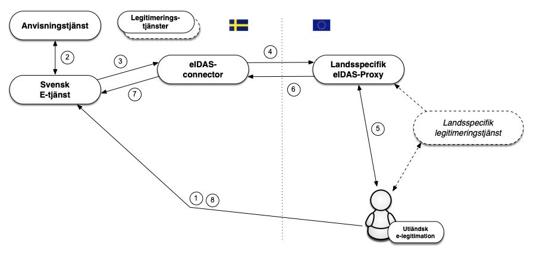

</img>
</img>

</img>

# En introduktion till Sweden Connect Tekniskt ramverk

### 2026-10-19

Diarienummer: **2019-267**

---

Copyright &copy; <a href="https://www.digg.se">Myndigheten för digital förvaltning (Digg)</a>, 2015-2026.

## Innehållsförteckning

1. [**Introduktion**](#introduktion)

    1.1. [Översikt](#oeversikt)

    1.2. [Tillitsramverk och säkerhetsnivåer](#tillitsramverk-och-saekerhetsnivaaer)

    1.3. [Tjänst för insamling, administration och publicering av metadata](#tjaenst-foer-insamling-administration-och-publicering-av-metadata)

    1.4. [Anvisningstjänst](#anvisningstjaenst)

    1.5. [Integration hos förlitande part](#integration-hos-foerlitande-part)

    1.6. [Underskrift](#underskrift)

    1.7. [Tekniskt ramverk och eIDAS](#tekniskt-ramverk-och-eidas)

    1.7.1. [Autentiseringar med utländska e-legitimationer](#autentiseringar-med-utlaendska-e-legitimationer)

    1.7.2. [Underskrifter med utländska e-legitimationer](#underskrifter-med-utlaendska-e-legitimationer)

    1.7.3. [Hantering av identiteter](#hantering-av-identiteter)

    1.7.4. [Svenska e-legitimationer i utländska e-tjänster](#svenska-e-legitimationer-i-utlaendska-e-tjaenster)

2. [**Tekniska specifikationer**](#tekniska-specifikationer)

    2.1. [Gemensamma specifikationer](#gemensamma-specifikationer)

    2.1.1. [Sweden Connect – Registry for Identifiers](#sc-registry-for-identifiers)

    2.1.2. [Sweden Connect – Security Requirements](#sc-security-requirements)

    2.2. [Profiler och specifikationer för SAML](#profiler-och-specifikationer-for-saml)

    2.2.1. [Deployment Profile for the Swedish eID Framework](#deployment-profile-for-the-swedish-eid-framework)

    2.2.2. [Attribute Specification for the Swedish eID Framework](#attribute-specification-for-the-swedish-eid-framework)

    2.2.3. [Entity Categories for the Swedish eID Framework](#entity-categories-for-the-swedish-eid-framework)

    2.2.4. [eIDAS Constructed Attributes Specification for the Swedish eID Framework](#eidas-constructed-attributes-specification-for-the-swedish-eid-framework)

    2.2.5. [Principal Selection in SAML Authentication Requests](#principal-selection-in-saml-authentication-requests)

    2.2.6. [User Message Extension in SAML Authentication Requests](#user-message-extension-in-saml-authentication-requests)

    2.3. [Profiler och specifikationer för OpenID Connect](#profiler-och-specifikationer-for-openid-connect)

    2.3.1. [OpenID Connect Profile for Sweden Connect](#openid-connect-profile-for-sweden-connect)

    2.3.2. [OpenID Connect Claims and Scopes Specification for Sweden Connect](#openid-connect-claims-and-scopes-specification-for-sweden-connect)

    2.4. [Specifikationer för underskrift](#specifikationer-foer-underskrift)

    2.4.1. [Implementation Profile for using OASIS DSS in Central Signing Services](#implementation-profile-oasis-dss)

    2.4.2. [DSS Extension for Federated Central Signing Services](#dss-extensions)

    2.4.3. [Certificate Profile for Certificates Issued by Central Signing Services](#certificate-profile-css)

    2.4.4. [Signature Activation Protocol for Federated Signing](#signature-activation)

    2.5. [Sweden Connect-federationen](#sweden-connect-federationen)

    2.5.1. [Tekniska anslutningsregler för Sweden Connect-federationen](#tekniska-anslutningsregler)

    2.5.2. [Sweden Connect – OpenID Federation Rules and Policies](#sc-oidf-rules)

    2.5.3. [Sweden Connect – OpenID Federation Structure](#sc-oidf-structure)

    2.5.4. [Sweden Connect – OpenID Connect Metadata Requirements](#sc-oidc-metadata-requirements)

    2.5.5. [OIDC Sweden – OpenID Federation Profiles and Specifications](#oidc-sweden-federation-specifications)

3. [**Referenslista**](#referenslista)

    3.1. [Digg](#digg)

    3.2. [OIDC Sweden](#oidc-sweden)

    3.3. [Övriga referenser](#oevriga-referenser)

## 1. Introduktion

### 1.1. Översikt

Sweden Connect Tekniskt ramverk, även kallat Swedish eID Framework, är anpassat för identitetsfederationer som baseras på SAML 2.0 och OpenID Connect.

Förlitande parter erhåller identitetsintyg i ett standardiserat format från en legitimeringstjänst1. I SAML är identitetsintyget ett SAML-intyg (assertion). I OpenID Connect levereras identitetsuppgifterna i en ID-token och eventuellt även i svaret från UserInfo-endpointen.

I SAML intar e-tjänster och andra förlitande parter rollen som Service Provider (SP), medan tjänster som autentiserar användare och utfärdar identitetsintyg intar rollen som Identity Provider (IdP). I OpenID Connect är motsvarande roller Relying Party (RP) och OpenID Provider (OP). Detta dokument använder benämningarna "förlitande part" och "legitimeringstjänst" när texten gäller båda protokollen.

Förlitande parter som kräver underskrift behöver inte anpassas efter olika underskriftstekniker för olika typer av e-legitimationer. Istället använder en förlitande part en underskriftstjänst, där användare skriver under elektroniska handlingar genom att legitimera sig hos en legitimeringstjänst.

Då såväl personidentitetsuppgifter som andra attribut kopplade till användare tillhandahålls genom identitetsintyg, kan alla typer av e-legitimationer som har en legitimeringstjänst inom federationen användas av en förlitande part som kräver specifika identitetsattribut, även om e-legitimationen i sig inte innehåller dessa uppgifter.

> \[1\]: Legitimeringstjänst benämns i annan dokumentation från Digg också som identitetstjänst och intygstjänst. I detta dokument används dock uteslutande benämningen legitimeringstjänst.

### 1.2. Tillitsramverk och säkerhetsnivåer

Grunden för vilken säkerhetsnivå som tillämpas när en användare legitimerar sig är den tillitsnivå för e-legitimationen som den förlitande parten kräver. För att dessa nivåer ska vara jämförbara inom federationen definieras fyra tillitsnivåer (1–4) i Tillitsramverket för Svensk e-legitimation \[[Digg.Tillit](#digg-tillit)\], och tre tillitsnivåer (låg, väsentlig, hög) i EU-förordningen eIDAS. Alla som utfärdar identitetsintyg måste visa att den process som ligger till grund för utfärdandet uppfyller kraven för den aktuella tillitsnivån. Detta innefattar bland annat:

-   Krav på skapandet av identitetsintyget.

-   Krav på den elektroniska legitimeringen (autentiseringen).

-   Krav på utfärdandeprocessen.

-   Krav på själva e-legitimationen och dess användning.

-   Krav på utfärdaren av e-legitimationen.

-   Krav på fastställande av den e-legitimationssökandes identitet.

### 1.3. Tjänst för insamling, administration och publicering av metadata

En federation tillhandahåller information om sina deltagare genom metadata. Deltagare i en federation är dels tjänster som tillhandahåller identitets- och attributintyg, dels förlitande parter som konsumerar dessa tjänster.

Genom federationens metadata kan deltagare inhämta information om andra deltagares tjänster, inklusive de uppgifter som krävs för ett säkert informationsutbyte mellan tjänsterna. Varje part måste hålla sin metadata uppdaterad, och metadata måste överensstämma med avtalade villkor.

Det viktigaste syftet med metadata är att tillhandahålla de nycklar och certifikat som krävs för säker kommunikation och informationsutbyte mellan tjänster. Utöver nycklar innehåller metadata även annan information som behövs för samverkan mellan tjänster, till exempel adresser till funktioner som krävs, information om tillitsnivåer, tjänstekategorier och information för användargränssnitt.

I SAML-delen av federationen utgörs metadata av ett register i XML-format som är signerat med federationsoperatörens certifikat. Filen innehåller information om federationens medlemmar, inklusive deras certifikat. Eftersom filen med metadata är signerad räcker det att jämföra ett certifikat med dess motsvarighet i metadata. En infrastruktur baserad på ett centralt federationsregister förutsätter att registret uppdateras kontinuerligt och att federationsmedlemmarna alltid använder den senaste versionen av filen.

I OpenID Connect-delen av federationen hanteras metadata enligt OpenID Federation \[[OpenID.Federation](#openid-federation)\]. Varje entitet publicerar sin metadata i en signerad Entity Configuration, och Trust Anchor, tillsammans med eventuella Intermediate Entities, utfärdar signerade Subordinate Statements om de entiteter som är registrerade under dem. Tillit till en entitets metadata etableras genom att en Trust Chain byggs upp från entiteten till en Trust Anchor som federationen driver, och federationens metadatapolicyer tillämpas på metadata i samma process. Se avsnitt [2.5](#sweden-connect-federationen) för de specifikationer som gäller.

### 1.4. Anvisningstjänst

I en identitetsfederation är det möjligt att erbjuda och konsumera en gemensam anvisningstjänst (Discovery Service) som listar de legitimeringstjänster (eller e-legitimationer) som användaren kan välja mellan. Syftet med en sådan tjänst är att avlasta federationens enskilda förlitande parter från att själva implementera stöd för hur användare väljer hur de ska legitimera sig.

Genom att anvisningstjänsten finns tillgänglig inom identitetsfederationen kan förlitande parter styra sina användare dit för val av legitimeringstjänst. Anvisningstjänsten interagerar med användaren, som gör sitt val, och styr tillbaka användaren till den förlitande parten tillsammans med det valda alternativet. Den förlitande parten vet då till vilken legitimeringstjänst användaren ska skickas för legitimering.

> För närvarande finns ingen gemensam anvisningstjänst för Sweden Connect-federationen.

### 1.5. Integration hos förlitande part

Förlitande parter integrerar mot legitimeringstjänster genom standardiserade meddelanden och konsumerar identitetsintyg som också har ett standardiserat format.

För SAML är Sweden Connect Tekniskt ramverk influerat av interoperabilitetsprofilen "SAML V2.0 Deployment Profile for Federation Interoperability" \[[SAML2Int](#saml2int)\]. För OpenID Connect bygger ramverket på "The Swedish OpenID Connect Profile" \[[OIDC.Sweden.Profile](#oidc-sweden-profile)\], framtagen av OIDC Sweden, som i sin tur är en profil av OpenID Connect Core \[[OpenID.Core](#openid-core)\]. Båda protokollen stöds av ett flertal kommersiella produkter och lösningar med öppen källkod, vilket underlättar integrationen hos den förlitande parten.

De flesta förlitande parter använder fristående autentiseringslösningar, vilket innebär att den anpassning som krävs för att stödja Sweden Connect Tekniskt ramverk oftast begränsas till den autentiseringslösning som används.

### 1.6. Underskrift

Sweden Connect Tekniskt ramverk möjliggör underskrift med alla typer av e-legitimationer, även sådana som inte är certifikatbaserade, så länge det finns en legitimeringstjänst för den aktuella e-legitimationen. Detta är möjligt eftersom det identitetsintyg som utfärdas vid legitimering för underskrift är standardiserat.

Syftet med en underskriftstjänst är att erbjuda underskrift inom identitetsfederationer som följer Sweden Connect Tekniskt ramverk.

Genom att upphandla1 och införa en underskriftstjänst kan en förlitande part inom federationen erbjuda sina användare att skriva under elektroniska handlingar med stöd av underskriftstjänsten. Användarens underskrift och tillhörande signeringscertifikat skapas av underskriftstjänsten efter att användaren har godkänt underskriften genom att legitimera sig för underskriftstjänsten2.

Underskriftstjänsten agerar förlitande part mot federationens legitimeringstjänster. Användaren kan legitimera sig för underskrift antingen hos en SAML Identity Provider, med funktionen "legitimering för underskrift" i \[[SAML.Profile](#saml-profile)\], eller hos en OpenID Provider, med "Signature Extension for OpenID Connect" \[[OIDC.Sweden.Sign](#oidc-sweden-sign)\] så som den profileras i \[[OIDC.Profile](#oidc-profile)\].

> \[1\]: Det är också möjligt för en förlitande part att själv implementera en underskriftstjänst baserat på specifikationerna.

> \[2\]: Det är av största vikt att användaren förstår att han eller hon skriver under en handling. Därför bör ett underskriftsflöde användas vid "legitimering för underskrift" för de e-legitimationer som stödjer detta.

### 1.7. Tekniskt ramverk och eIDAS

EU-förordningen ([910/2014](http://eur-lex.europa.eu/legal-content/SV/TXT/PDF/?uri=CELEX:32014R0910&from=EN)) om elektronisk identifiering och betrodda tjänster, eIDAS, kräver att svenska offentliga organ erkänner de e-legitimationer som andra eIDAS-länder har anmält. Detta innebär att en svensk offentlig e-tjänst, under vissa förutsättningar, måste kunna acceptera en inloggning som utförs med en e-legitimation utfärdad i ett annat land.

#### 1.7.1. Autentiseringar med utländska e-legitimationer

De tekniska specifikationerna för eIDAS bygger, liksom SAML-delen av Sweden Connect Tekniskt ramverk, på SAML-standarder och profiler. Även om likheterna är många finns det också skillnader mellan specifikationerna. En svensk e-tjänst behöver dock inte förhålla sig direkt till eIDAS tekniska specifikationer. Bilden nedan illustrerar hur den svenska eIDAS-noden (*eIDAS-connector*) agerar som en brygga mellan andra länder och den svenska federationen när en person autentiseras med en utländsk e-legitimation hos en svensk e-tjänst.

Flödet är enligt följande:

1.  En användare med en utländsk e-legitimation begär åtkomst till en svensk e-tjänst (d.v.s. vill logga in).
    
2.  E-tjänsten låter användaren välja inloggningssätt med hjälp av en anvisningstjänst. I detta fall väljer användaren alternativet "Foreign eID".

3.  E-tjänsten skapar en legitimeringsbegäran enligt Sweden Connect Tekniskt ramverk och styr användaren till den svenska eIDAS-noden (*connector*). eIDAS-noden uppträder som en legitimeringstjänst inom federationen, vilket innebär att kommunikationen med denna tjänst sker på samma sätt som med andra legitimeringstjänster som följer Sweden Connect Tekniskt ramverk.

4.  Den mottagna begäran behandlas och eIDAS-noden visar en sida där användaren väljer sitt land1. Den svenska eIDAS-noden omvandlar sedan den mottagna legitimeringsbegäran till en legitimeringsbegäran enligt eIDAS-formatet och styr användaren till det valda landets *eIDAS Proxy-tjänst*.

5.  När legitimeringsbegäran behandlas av det valda landets eIDAS Proxy-tjänst används det landets teknik för autentisering. Inte alla eIDAS-länder använder SAML för autentisering, men om så vore fallet i vårt exempel skulle användaren styras vidare till en nationell legitimeringstjänst, eventuellt via en anvisningstjänst där användaren väljer vilken e-legitimation som ska användas.

6.  När användaren har autentiserats skapas ett identitetsintyg enligt eIDAS specifikationer. Intyget innehåller eIDAS-specifika attribut som identifierar användaren. Intyget skickas tillbaka till den svenska eIDAS-noden.

7.  Noden tar emot intyget och kontrollerar dess giltighet. Intyget omvandlas från eIDAS-format till ett intyg enligt Sweden Connect Tekniskt ramverk och skickas till e-tjänsten.
    
8.  E-tjänsten kan nu komplettera med ytterligare information för att avgöra om användaren ska ges åtkomst till tjänsten.

Svenska e-tjänster behöver alltså endast stödja Sweden Connect Tekniskt ramverk, även när utländska användare autentiseras. För att e-tjänsten fullt ut ska kunna acceptera den autentiserade användaren måste den dock också kunna hantera den presenterade identiteten, som sannolikt inte är ett svenskt personnummer. Se avsnitt 1.7.3 nedan.

> \[1\]: Mer korrekt uttryckt väljer användaren till vilken eIDAS Proxy-tjänst begäran ska skickas. Detta beror på i vilket land användarens e-legitimation är utfärdad.

#### 1.7.2. Underskrifter med utländska e-legitimationer

Som redan beskrivits tillämpas en modell för underskrift som kallas "federerad underskrift" inom ramen för Sweden Connect Tekniskt ramverk. En serverbaserad underskriftstjänst knyts till den e-tjänst som begär underskrifter. När en användare skriver under ett dokument skickar e-tjänsten användaren, tillsammans med en underskriftsbegäran, till underskriftstjänsten. Underskriftstjänsten begär därefter att användaren legitimerar sig hos en legitimeringstjänst. I samband med legitimeringen godkänner användaren underskriften. Underskriftstjänsten skickar sedan tillbaka användaren till e-tjänsten tillsammans med underskriftsuppgifterna, och e-tjänsten lagrar underskriften som ett undertecknat dokument.

Detta förfarande gör det möjligt för svenska e-tjänster att erbjuda underskrift för användare med utländska e-legitimationer, eftersom en underskriftstjänst kan välja att legitimera en användare med utländsk e-legitimation enligt det förfarande som beskrivs i avsnitt 1.7.1 ovan.

I detta fall ansvarar den svenska eIDAS-noden för att informera användaren om att syftet med legitimeringen är att godkänna underskriften av ett dokument, och visar information om vem som begärt underskriften och om vad som skrivs under. När användaren har legitimerat sig utfärdas ett identitetsintyg som skickas till underskriftstjänsten, som därefter skapar underskriften.

#### 1.7.3. Hantering av identiteter

Identitetsintyg från andra länder följer gemensamma tekniska specifikationer inom ramen för eIDAS-förordningen. Dessa specifikationer definierar ett *Minimum Data Set* (MDS), d.v.s. en uppsättning attribut som varje land måste tillhandahålla för autentiserade fysiska och juridiska personer. Varje land måste tillhandahålla en unik identifierare per e-legitimation som representerar en fysisk person. Från vissa länder kommer dessa identifierare att vara unika och beständiga per person på motsvarande sätt som svenska personnummer, men identifierarna kan ha olika sammansättning och egenskaper. En egenskap som kan variera är hur beständig en personidentifierare är, d.v.s. om identifieraren är oförändrad under en persons livstid eller om den ändras när användaren flyttar till en annan region, byter namn eller helt enkelt skaffar en ny e-legitimation. Från vissa länder kommer identifieraren att vara olika beroende på vilken av landets e-legitimationer användaren för tillfället använder.

För att förenkla hanteringen av användare och identiteter i svenska e-tjänster genererar den svenska eIDAS-noden ett standardiserat identitetsattribut för användare som har legitimerats med utländsk e-legitimation, ett så kallat *Provisional ID* (PRID). eIDAS-noden skapar även ett attribut som anger PRID-attributets förväntade beständighet, eller livslängd. PRID-attributet genereras utifrån de attributvärden som tas emot från den utländska legitimeringen, enligt specifika metoder för respektive land. Varje kombination av land och metod klassas utifrån förväntad beständighet, d.v.s. hur sannolikt det är att en persons identitet ändras över tid. Detta gör det möjligt för svenska e-tjänster att anpassa kommunikationen med användaren och proaktivt erbjuda funktioner för en användare vars identitet har ändrats, så att användaren kan komma åt sitt konto.

I vissa fall kan en person som har legitimerats med en utländsk e-legitimation även ha ett svenskt personnummer. Det kan till exempel röra sig om en svensk medborgare som har flyttat utomlands och skaffat en utländsk e-legitimation, eller en utländsk medborgare som är, eller har varit, folkbokförd i Sverige och har tilldelats ett svenskt personnummer.

#### 1.7.4. Svenska e-legitimationer i utländska e-tjänster

Sverige har anmält svenska e-legitimationer på tillitsnivåerna väsentlig (substantial) och hög (high) enligt eIDAS.

En begäran om legitimering från en utländsk e-tjänst skickas till den svenska eIDAS-noden (*eIDAS Proxy-tjänst*) via en eIDAS-connector i e-tjänstens land. I den svenska eIDAS-noden väljer användaren vilken svensk e-legitimation han eller hon vill använda för att legitimera sig, och en legitimeringsbegäran skickas till den legitimeringstjänst som erbjuder legitimering för den valda e-legitimationen. Denna begäran följer Sweden Connect Tekniskt ramverk, vilket innebär att en svensk legitimeringstjänst inte behöver följa eIDAS tekniska specifikationer.

Användaren autentiseras hos den svenska legitimeringstjänsten och ett identitetsintyg utfärdas enligt Sweden Connect Tekniskt ramverk. Intyget tas emot av den svenska eIDAS-noden (Proxy-tjänsten) och omvandlas till ett intyg enligt eIDAS specifikationer innan det skickas till den utländska eIDAS-connectorn och därefter till den utländska e-tjänst som initierade begäran.

## 2. Tekniska specifikationer

Detta kapitel listar specifikationer och profiler för identitetsfederationer och kringliggande tjänster som följer Sweden Connect Tekniskt ramverk. Där inget annat anges är dessa dokument normativa för leverans av tjänster inom identitetsfederationer som implementerar Sweden Connect Tekniskt ramverk.

### 2.1. Gemensamma specifikationer

Specifikationerna i detta avsnitt gäller både SAML-delen och OpenID Connect-delen av Sweden Connect Tekniskt ramverk.

#### 2.1.1. Sweden Connect – Registry for Identifiers

Implementering av en infrastruktur för svenska e-legitimationer kräver olika former av identifierare för att representera objekt i datastrukturer. Dokumentet "Sweden Connect – Registry for Identifiers", \[[SC.Registry](#sc-registry)\], definierar strukturen för identifierare som tilldelas inom ramen för Sweden Connect Tekniskt ramverk, och innehåller ett register över definierade identifierare.

#### 2.1.2. Sweden Connect – Security Requirements

Specifikationen "Sweden Connect – Security Requirements", \[[SC.Security](#sc-security)\], definierar säkerhetskraven för deltagare i Sweden Connect-federationen. Den omfattar transportskydd, kryptografiska algoritmer, nyckellängder och nyckelbyte.

### 2.2. Profiler och specifikationer för SAML

Identitetsfederationer som följer SAML-delen av Sweden Connect Tekniskt ramverk är uppbyggda kring "Deployment Profile for the Swedish eID Framework", \[[SAML.Profile](#saml-profile)\]. Denna profil är influerad av, men inte normativt beroende av, "SAML V2.0 Deployment Profile for Federation Interoperability" \[[SAML2Int](#saml2int)\]. \[[SAML.Profile](#saml-profile)\] innehåller också regler och riktlinjer specifika för Sweden Connect Tekniskt ramverk.

#### 2.2.1. Deployment Profile for the Swedish eID Framework

"Deployment Profile for the Swedish eID Framework", \[[SAML.Profile](#saml-profile)\], är huvudspecifikationen för SAML i Sweden Connect Tekniskt ramverk och omfattar:

- Hur SAML-metadata byggs upp och tolkas.

- Hur en legitimeringsbegäran utformas.

- Hur en legitimeringsbegäran behandlas, och hur ett identitetsintyg konstrueras, verifieras och behandlas.

- Säkerhetskrav.

- Specifika SAML-krav för underskriftstjänster och "legitimering för underskrift".

#### 2.2.2. Attribute Specification for the Swedish eID Framework

Specifikationen "Attribute Specification for the Swedish eID Framework", \[[SAML.Attributes](#saml-attributes)\], deklarerar de SAML-attributprofiler som används inom identitetsfederationer som följer Sweden Connect Tekniskt ramverk, inklusive tjänster som ansluter till eIDAS via den svenska eIDAS-noden.

#### 2.2.3. Entity Categories for the Swedish eID Framework

Entitetskategorier (Entity Categories) används inom SAML-delen av federationen för ett antal olika syften:

-   Service Entity Categories – Används i metadata för att representera e-tjänsters krav på tillitsnivåer och attribut, samt legitimeringstjänsters deklarationer av vilka tillitsnivåer de stödjer och vilka attribut de kan leverera.

-   Service Property Categories – Används för att representera vissa egenskaper hos tjänster inom federationen.

-   Service Type Entity Categories – Representerar olika tjänstetyper inom federationen.
    
-   Service Contract Entity Categories – Används av tjänster för att deklarera juridiska och affärsmässiga avtal.
    
-   General Entity Categories – Entitetskategorier som inte faller inom ramen för någon av de övriga typerna.

Specifikationen "Entity Categories for the Swedish eID Framework", \[[SAML.EntCat](#saml-entcat)\], specificerar de entitetskategorier som definieras i Sweden Connect Tekniskt ramverk och beskriver deras betydelse.

#### 2.2.4. eIDAS Constructed Attributes Specification for the Swedish eID Framework

Specifikationen "eIDAS Constructed Attributes Specification for the Swedish eID Framework", \[[SC.eIDAS.Attrs](#sc-eidas-attrs)\], definierar processer och regler för hur identitetsattribut konstrueras utifrån de attribut som tas emot vid legitimering via eIDAS.

#### 2.2.5. Principal Selection in SAML Authentication Requests

Specifikationen "Principal Selection in SAML Authentication Requests", \[[SAML.Principal](#saml-principal)\], definierar en utökning av SAML som gör det möjligt för en e-tjänst att informera en legitimeringstjänst om identiteten för den användare som den önskar ska legitimeras.

#### 2.2.6. User Message Extension in SAML Authentication Requests

Specifikationen "User Message Extension in SAML Authentication Requests", \[[SAML.UMessage](#saml-umessage)\], definierar en utökning av SAML som gör det möjligt för en e-tjänst att inkludera ett meddelande i den legitimeringsbegäran som skickas till legitimeringstjänsten. Legitimeringstjänsten kan då visa meddelandet för användaren under legitimeringen.

### 2.3. Profiler och specifikationer för OpenID Connect

De specifikationer för OpenID Connect som ingår i Sweden Connect Tekniskt ramverk bygger på de OpenID Connect-specifikationer som tagits fram av [OIDC Sweden](https://www.oidc.se), och utökar dem med krav, claims och scopes specifika för Sweden Connect-federationen. Följande specifikationer från OIDC Sweden används:

- "The Swedish OpenID Connect Profile", \[[OIDC.Sweden.Profile](#oidc-sweden-profile)\], är en OpenID Connect-profil som etablerar en grundläggande säkerhetsnivå och främjar interoperabilitet mellan Relying Parties och OpenID Providers i svenska lösningar.

- "Claims and Scopes Specification for the Swedish OpenID Connect Profile", \[[OIDC.Sweden.Claims](#oidc-sweden-claims)\], definierar claims och scopes för den svenska OpenID Connect-profilen.

- "Authentication Request Parameter Extensions for the Swedish OpenID Connect Profile", \[[OIDC.Sweden.RPar](#oidc-sweden-rpar)\], definierar ytterligare parametrar för legitimeringsbegäran, till exempel en parameter för att visa ett meddelande för användaren under legitimeringen.

- "Signature Extension for OpenID Connect", \[[OIDC.Sweden.Sign](#oidc-sweden-sign)\], definierar en utökning där en Relying Party, till exempel en underskriftstjänst, skickar en underskriftsbegäran till en OpenID Provider.

De specifikationer som behövs för att ansluta till OpenID Connect-delen av federationen, till exempel metadatakraven, listas i avsnitt [2.5](#sweden-connect-federationen).

#### 2.3.1. OpenID Connect Profile for Sweden Connect

Profilen "OpenID Connect Profile for Sweden Connect", \[[OIDC.Profile](#oidc-profile)\], bygger vidare på "The Swedish OpenID Connect Profile", \[[OIDC.Sweden.Profile](#oidc-sweden-profile)\], med ytterligare krav på Relying Parties och OpenID Providers i Sweden Connect-federationen. Detta omfattar till exempel krav på single sign-on, klientautentisering, innehåll i ID-token och stöd för "Signature Extension for OpenID Connect" \[[OIDC.Sweden.Sign](#oidc-sweden-sign)\].
    

#### 2.3.2. OpenID Connect Claims and Scopes Specification for Sweden Connect

Specifikationen "OpenID Connect Claims and Scopes Specification for Sweden Connect", \[[OIDC.Claims](#oidc-claims)\], bygger vidare på "Claims and Scopes Specification for the Swedish OpenID Connect Profile", \[[OIDC.Sweden.Claims](#oidc-sweden-claims)\], med claims och scopes för användning inom Sweden Connect-federationen, inklusive definitioner för eIDAS.

### 2.4. Specifikationer för underskrift

Detta avsnitt innehåller referenser till de dokument som definierar underskriftstjänster inom federationer som följer Sweden Connect Tekniskt ramverk.

#### 2.4.1. Implementation Profile for using OASIS DSS in Central Signing Services

"Implementation Profile for using OASIS DSS in Central Signing Services", \[[Sign.DSS.Profile](#sign-dss-profile)\], specificerar en profil för underskriftsbegäran och svar enligt OASIS-standarden "Digital Signature Service Core Protocols, Elements, and Bindings", \[[DSS](#dss)\].

#### 2.4.2. DSS Extension for Federated Central Signing Services

"DSS Extension for Federated Central Signing Services", \[[Sign.DSS.Ext](#sign-dss-ext)\], är en utökning av OASIS-standarden "Digital Signature Service Core Protocols, Elements, and Bindings", \[[DSS](#dss)\], som specificerar de definitioner som behövs för underskrift enligt Sweden Connect Tekniskt ramverk.

#### 2.4.3. Certificate Profile for Certificates Issued by Central Signing Services

"Certificate Profile for Certificates Issued by Central Signing Services", \[[Sign.Cert.Profile](#sign-cert-profile)\], specificerar innehållet i signeringscertifikat och definierar en certifikatextension för användning av underskriftstjänster.

Denna profil refererar till "Authentication Context Certificate Extension", \[[AuthContext](#authcontext)\], som beskriver hur en autentiseringskontext representeras i X.509-certifikat.

#### 2.4.4. Signature Activation Protocol for Federated Signing

Specifikationen "Signature Activation Protocol for Federated Signing", \[[Sign.Activation](#sign-activation)\], definierar ett Signature Activation Protocol (SAP) för implementering av Sole Control Assurance Level 2 (SCAL2) enligt standarden "prEN 419241 - Trustworthy Systems Supporting Server Signing".

### 2.5. Sweden Connect-federationen

Detta avsnitt listar de dokument som behövs för att ansluta till Sweden Connect-federationen, utöver säkerhetskraven i avsnitt [2.1.2](#sc-security-requirements). Avsnitt 2.5.1 gäller SAML-delen av federationen, och avsnitt 2.5.2 till 2.5.5 gäller OpenID Connect-delen, som baseras på OpenID Federation \[[OpenID.Federation](#openid-federation)\].

#### 2.5.1. Tekniska anslutningsregler för Sweden Connect-federationen

Dokumentet "Tekniska anslutningsregler för Sweden Connect-federationen", \[[SC.SAML.Rules](#sc-saml-rules)\], är den normativa specifikationen för parter som ansluter till SAML-delen av Sweden Connect-federationen. Det omfattar de avtal som ger tillgång till federationen, tillitsnivåer, krav på legitimering och attributleverans samt reglerna för registrering av metadata.

#### 2.5.2. Sweden Connect – OpenID Federation Rules and Policies

Dokumentet "Sweden Connect – OpenID Federation Rules and Policies", \[[SC.OIDF.Rules](#sc-oidf-rules-ref)\], innehåller federationsreglerna för OpenID Connect-delen av Sweden Connect-federationen och är ingångsdokumentet för deltagare. Det anger vad Relying Parties och OpenID Providers måste uppfylla, inklusive Trust Marks, registreringspolicyer och stegen för att ansluta till federationen.

#### 2.5.3. Sweden Connect – OpenID Federation Structure

Dokumentet "Sweden Connect – OpenID Federation Structure", \[[SC.OIDF.Structure](#sc-oidf-structure-ref)\], beskriver hur OpenID Connect-delen av Sweden Connect-federationen är uppbyggd, och anger Entity Identifiers, endpoints och Trust Anchor-nycklar för miljöerna Production, QA och Sandbox.

#### 2.5.4. Sweden Connect – OpenID Connect Metadata Requirements

Specifikationen "Sweden Connect – OpenID Connect Metadata Requirements", \[[SC.OIDC.Metadata](#sc-oidc-metadata)\], definierar metadatakraven för Relying Parties och OpenID Providers, samt de metadatapolicyer som federationen tillämpar för att upprätthålla dem. Kraven gäller den resulterande metadatan, d.v.s. den metadata som erhålls när en entitets Trust Chain har tillämpats på den metadata som entiteten deklarerar om sig själv.

#### 2.5.5. OIDC Sweden – OpenID Federation Profiles and Specifications

Sweden Connect-federationens stöd för OpenID Federation bygger på följande profil och specifikationer från OIDC Sweden:

- "Swedish OpenID Federation Deployment and Interoperability Profile", \[[OIDC.Sweden.Fed](#oidc-sweden-fed)\], definierar en avgränsad delmängd av OpenID Federation, med förtydliganden och utökningar, så att OpenID Providers, Relying Parties och andra entiteter enkelt kan ansluta till en federation. Den beskriver också hur system utan fullt stöd för OpenID Federation kan delta.

- "OpenID Federation Organization Identifier Metadata Parameter", \[[OIDC.Sweden.OrgId](#oidc-sweden-orgid)\], definierar metadataparametern `organization_identifier`, som en entitet använder för att deklarera en unik identifierare för den organisation som äger den.

- "OpenID Federation Registration Policy", \[[OIDC.Sweden.RegPolicy](#oidc-sweden-regpolicy)\], definierar claimet `registration_policy` för Subordinate Statements, som anger vilka registreringspolicyer som tillämpades när en entitet registrerades i federationen.

- "OpenID Federation Entity Configuration Hosting", \[[OIDC.Sweden.Hosting](#oidc-sweden-hosting)\], definierar claimet `ec_location`, som anger var en entitets Entity Configuration kan hämtas. Detta gör det möjligt för en Intermediate Entity att tillhandahålla Entity Configurations för entiteter som saknar fullt stöd för OpenID Federation.

## 3. Referenslista

### 3.1. Digg

**\[Digg.Tillit\]**
> [Tillitsramverk för Svensk e-legitimation](https://www.digg.se/digitala-tjanster/e-legitimering/tillitsnivaer-for-e-legitimering/tillitsramverk-for-svensk-e-legitimation).

**\[SC.Registry\]**
> [Sweden Connect – Registry for Identifiers](https://docs.swedenconnect.se/technical-framework/latest/03_-_Registry_for_Identifiers.html).

**\[SAML.Profile\]**
> [Deployment Profile for the Swedish eID Framework](https://docs.swedenconnect.se/technical-framework/latest/02_-_Deployment_Profile_for_the_Swedish_eID_Framework.html).

**\[SAML.Attributes\]**
> [Attribute Specification for the Swedish eID Framework](https://docs.swedenconnect.se/technical-framework/latest/04_-_Attribute_Specification_for_the_Swedish_eID_Framework.html).

**\[SAML.EntCat\]**
> [Entity Categories for the Swedish eID Framework](https://docs.swedenconnect.se/technical-framework/latest/06_-_Entity_Categories_for_the_Swedish_eID_Framework.html).

**\[SC.eIDAS.Attrs\]**
> [eIDAS Constructed Attributes Specification for the Swedish eID Framework](https://docs.swedenconnect.se/technical-framework/latest/11_-_eIDAS_Constructed_Attributes_Specification_for_the_Swedish_eID_Framework.html).

**\[SAML.Principal\]**
> [Principal Selection in SAML Authentication Requests](https://docs.swedenconnect.se/technical-framework/latest/14_-_Principal_Selection_in_SAML_Authentication_Requests.html).

**\[SAML.UMessage\]**
> [User Message Extension in SAML Authentication Requests](https://docs.swedenconnect.se/technical-framework/latest/18_-_User_Message_Extension_in_SAML_Authentication_Requests.html).

**\[OIDC.Profile\]**
> [OpenID Connect Profile for Sweden Connect](https://docs.swedenconnect.se/technical-framework/latest/OpenID_Connect_Profile_for_Sweden_Connect.html).

**\[OIDC.Claims\]**
> [OpenID Connect Claims and Scopes Specification for Sweden Connect](https://docs.swedenconnect.se/technical-framework/latest/OpenID_Connect_Claims_and_Scopes_Specification.html).

**\[Sign.DSS.Profile\]**
> [Implementation Profile for using OASIS DSS in Central Signing Services](https://docs.swedenconnect.se/technical-framework/latest/07_-_Implementation_Profile_for_using_DSS_in_Central_Signing_Services.html).

**\[Sign.DSS.Ext\]**
> [DSS Extension for Federated Central Signing Services](https://docs.swedenconnect.se/technical-framework/latest/09_-_DSS_Extension_for_Federated_Signing_Services.html).

**\[Sign.Cert.Profile\]**
> [Certificate Profile for Certificates Issued by Central Signing Services](https://docs.swedenconnect.se/technical-framework/latest/08_-_Certificate_Profile_for_Central_Signing_Services.html).

**\[Sign.Activation\]**
> [Signature Activation Protocol for Federated Signing](https://docs.swedenconnect.se/technical-framework/latest/13_-_Signature_Activation_Protocol.html).

**\[SC.Security\]**
> [Sweden Connect – Security Requirements 1.0](https://docs.swedenconnect.se/federation/security-requirements.html).

**\[SC.SAML.Rules\]**
> [Tekniska anslutningsregler för Sweden Connect-federationen](https://docs.swedenconnect.se/technical-framework/Tekniska_anslutningsregler.html).

**\[SC.OIDF.Rules\]**
> [Sweden Connect – OpenID Federation Rules and Policies 1.0](https://docs.swedenconnect.se/federation/oidf-rules.html).

**\[SC.OIDF.Structure\]**
> [Sweden Connect – OpenID Federation Structure](https://docs.swedenconnect.se/federation/oidf-structure.html).

**\[SC.OIDC.Metadata\]**
> [Sweden Connect – OpenID Connect Metadata Requirements 1.0](https://docs.swedenconnect.se/federation/oidc-metadata-requirements.html).

### 3.2. OIDC Sweden

**\[OIDC.Sweden.Profile\]**
> [The Swedish OpenID Connect Profile - Version 1.0](https://www.oidc.se/specifications/swedish-oidc-profile-1_0.html).

**\[OIDC.Sweden.Claims\]**
> [Claims and Scopes Specification for the Swedish OpenID Connect Profile - Version 1.0](https://www.oidc.se/specifications/swedish-oidc-claims-specification-1_0.html).

**\[OIDC.Sweden.RPar\]**
> [Authentication Request Parameter Extensions for the Swedish OpenID Connect Profile - Version 1.1](https://www.oidc.se/specifications/request-parameter-extensions-1_1.html).

**\[OIDC.Sweden.Sign\]**
> [Signature Extension for OpenID Connect - Version 1.2](https://www.oidc.se/specifications/oidc-signature-extension-1_2.html).

**\[OIDC.Sweden.Fed\]**
> [Swedish OpenID Federation Deployment and Interoperability Profile - Version 1.0](https://www.oidc.se/specifications/swedish-openid-federation-profile-1_0.html).

**\[OIDC.Sweden.OrgId\]**
> [OpenID Federation Organization Identifier Metadata Parameter - Version 1.0](https://www.oidc.se/specifications/openid-federation-organization-identifier-1_0.html).

**\[OIDC.Sweden.RegPolicy\]**
> [OpenID Federation Registration Policy - Version 1.0](https://www.oidc.se/specifications/openid-federation-registration-policy-1_0.html).

**\[OIDC.Sweden.Hosting\]**
> [OpenID Federation Entity Configuration Hosting - Version 1.0](https://www.oidc.se/specifications/openid-federation-hosting-1_0.html).

### 3.3. Övriga referenser

**\[OpenID.Core\]**
> [Sakimura, N., Bradley, J., Jones, M., de Medeiros, B. and C. Mortimore, "OpenID Connect Core 1.0", August 2015](https://openid.net/specs/openid-connect-core-1_0.html).

**\[OpenID.Federation\]**
> [Hedberg, R., Jones, M.B., Solberg, A.Å., Bradley, J., De Marco, G. and V. Dzhuvinov, "OpenID Federation 1.0"](https://openid.net/specs/openid-federation-1_0.html).

**\[SAML2Int\]**
> [SAML V2.0 Deployment Profile for Federation Interoperability](https://kantarainitiative.github.io/SAMLprofiles/saml2int.html).

**\[DSS\]**
> [OASIS Standard – Digital Signature Service Core Protocols, Elements, and Bindings Version 1.0, April 11, 2007](http://docs.oasis-open.org/dss/v1.0/oasis-dss-core-spec-v1.0-os.doc).

**\[AuthContext\]**
> [RFC-7773: Authentication Context Certificate Extension](https://tools.ietf.org/html/rfc7773).
